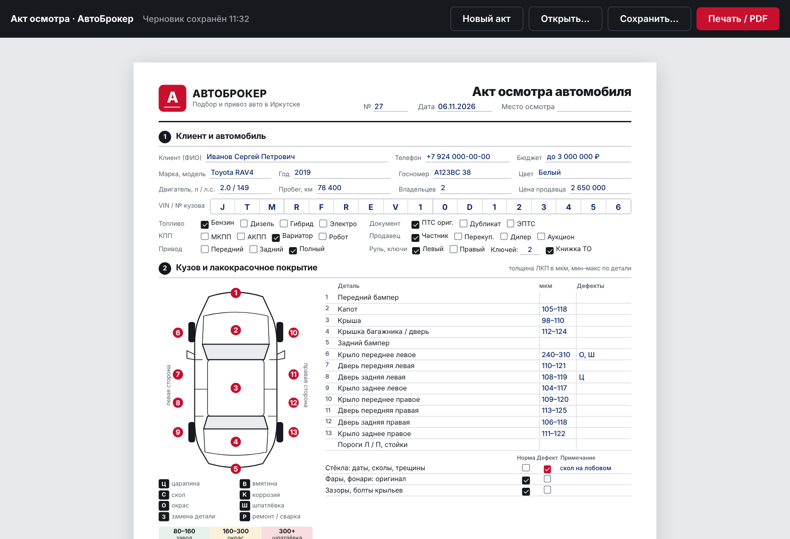
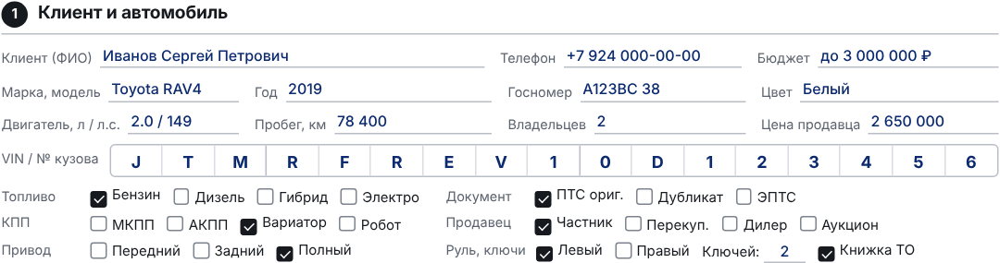
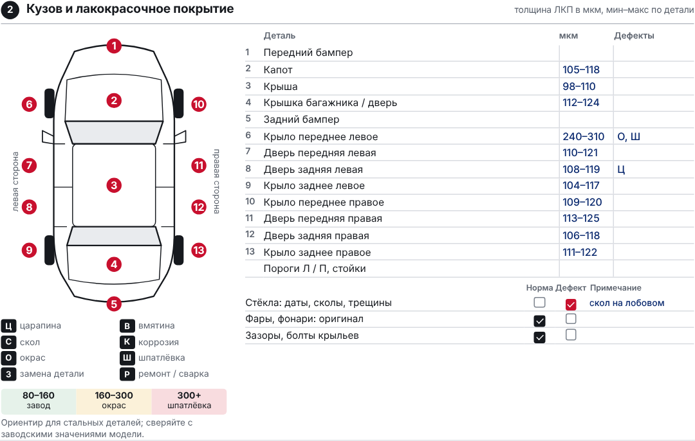
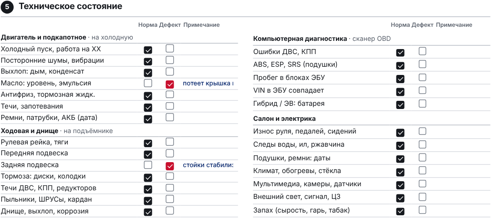
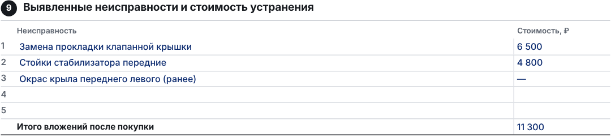
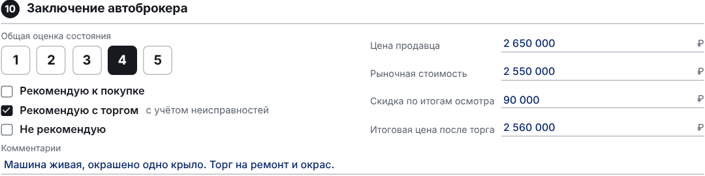
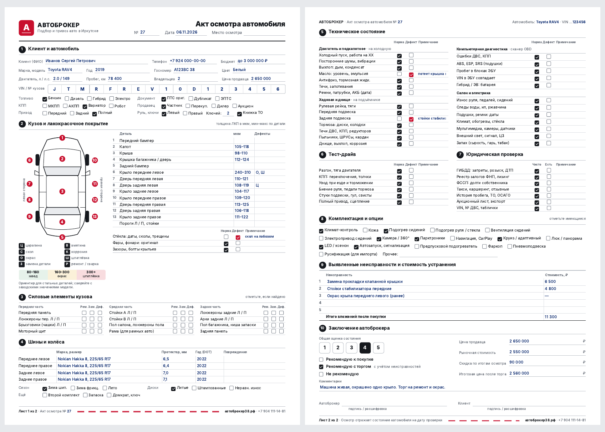

<div align="center">


# Акт осмотра автомобиля

**Программа для автоброкера: заполняемый бланк осмотра авто с пробегом с печатью на 2 листа A4**

АвтоБрокер · Подбор и привоз авто в Иркутске · [автоброкер38.рф](https://автоброкер38.рф)

</div>

---



## Что это

Электронная версия бланка, с которым автоброкер выезжает на осмотр. Все поля заполняются с клавиатуры, галочки ставятся кликом. Акт можно сохранить, открыть позже и распечатать или отдать клиенту в PDF. На бумаге он выглядит точно так же, как на экране.

- **10 разделов на 2 листах**: от данных клиента до итоговой рекомендации и подписей
- **Замер ЛКП по 13 деталям** со схемой кузова и шкалой «завод / окрас / шпатлёвка»
- **Автосохранение черновика**: закрыли окно, открыли, данные на месте
- **Работает без интернета**: файлы акта хранятся у вас на компьютере

---

## Быстрый старт

### Вариант 1. Сразу, без установки

Дважды кликните **`akt_osmotra.html`**: бланк откроется в браузере (Chrome, Edge, Яндекс) и уже готов к работе.

### Вариант 2. Отдельная программа `AktOsmotra.exe`

Своё окно, иконка на рабочем столе, сохранение в папку «Документы».

1. Установите **Python 3.10 или новее** с [python.org](https://www.python.org/downloads/). При установке отметьте галочку **Add python.exe to PATH**.
2. Дважды кликните **`build.bat`**. Скрипт сам установит нужные пакеты и соберёт программу, это 1–3 минуты.
3. Готовая программа появится в **`dist\AktOsmotra.exe`**. Скопируйте её на рабочий стол или флешку: для запуска Python больше не нужен.

> Программа работает на Windows 10 и 11. Окно использует встроенный в Windows компонент Microsoft Edge WebView2.

---

## Как заполнять

### Панель управления


| Кнопка | Что делает |
|---|---|
| **Новый акт** | Очищает бланк и ставит сегодняшнюю дату |
| **Открыть…** | Загружает ранее сохранённый акт (файл `.json`) |
| **Сохранить…** | Сохраняет акт в файл. Имя подставляется само: `Акт №27 Toyota RAV4 06.11.2026.json` |
| **Печать / PDF** | Печать на принтере или сохранение в PDF |

Слева в панели видно, когда черновик сохранился в последний раз.

### Лист 1. Клиент, автомобиль, кузов



- **VIN** можно вставить целиком (`Ctrl+V`) в первую клетку: он сам разложится по 17 клеткам. При вводе вручную курсор переходит дальше автоматически, `Backspace` возвращает назад.
- Варианты (топливо, КПП, привод, документ, продавец) отмечаются кликом по квадратику или по подписи.
- `Enter` переходит к следующему полю.



- Номера деталей на схеме совпадают с таблицей: записывайте толщину ЛКП в мкм (мин–макс по детали) и коды дефектов из легенды: **Ц** царапина, **В** вмятина, **С** скол, **К** коррозия, **О** окрас, **Ш** шпатлёвка, **З** замена, **Р** ремонт.
- В строках **«Норма / Дефект»** можно отметить только одно. Дефект подсвечивается красным, так его видно сразу.

### Лист 2. Техника, юр. проверка, итог



Проверки сгруппированы по месту осмотра: подкапотное на холодную, подъёмник, сканер OBD, салон и электрика. Затем идут тест-драйв и юридическая проверка (ГИБДД, залоги ФНП, ФССП, такси, история, аукционный лист).





- **Оценка 1–5** выбирается кнопкой.
- **Рекомендация**: только один вариант из трёх.
- Номер акта, модель и последние 6 знаков VIN **сами подставляются** в шапку второго листа и в подвал.

---

## Печать и PDF



Нажмите **Печать / PDF** и в окне печати выберите:

| Настройка | Значение |
|---|---|
| Принтер | Ваш принтер или **Сохранить как PDF** |
| Формат | A4, книжная |
| Поля | Нет |
| Колонтитулы | Выключить |
| Фоновая графика | **Включить**, иначе пропадут цветные элементы |

Чистый бланк для ручного заполнения ручкой: нажмите **Новый акт**, очистите дату и распечатайте.

---

## Где хранятся данные

| Что | Где |
|---|---|
| Сохранённые акты (программа) | `Документы\Акты осмотра\*.json` |
| Сохранённые акты (браузер) | Папка «Загрузки» |
| Черновик (программа) | `%APPDATA%\AvtoBroker\AktOsmotra` |
| Черновик (браузер) | Память браузера, отдельно для каждого браузера |

Файл акта `.json` открывается и в программе, и в браузерной версии: их можно пересылать друг другу.

---

## Состав папки

```
Акт осмотра - программа/
├── akt_osmotra.html   — сам бланк (вёрстка, стили, логика заполнения)
├── app.py             — программа-окно на pywebview, сохранение и открытие файлов
├── build.bat          — сборка AktOsmotra.exe одним кликом
├── icon.ico           — иконка программы
├── README.md          — это описание
├── README.txt         — краткая инструкция
└── screenshots/       — картинки для описания
```

Запуск без сборки, для проверки: `python app.py` (нужен `pip install pywebview`).

## Вопросы и решения

**`build.bat` пишет «Python не найден»**
Переустановите Python и отметьте **Add python.exe to PATH**, затем запустите `build.bat` ещё раз.

**Антивирус ругается на `AktOsmotra.exe`**
Так бывает с программами, собранными PyInstaller, у которых нет цифровой подписи. Добавьте файл в исключения антивируса.

**Длинный текст в «Примечании» обрезается на печати**
Колонка узкая: пишите туда коротко, подробности — в «Комментарии» в конце акта.

**Нужно поменять телефон или сайт в подвале бланка**
Откройте `akt_osmotra.html` в PyCharm, найдите `+7 904 111-14-81` (встречается 2 раза) и замените. Затем пересоберите `.exe` через `build.bat`.

---

<div align="center">

**АвтоБрокер** · Подбор и привоз авто в Иркутске
[автоброкер38.рф](https://автоброкер38.рф) · +7 904 111-14-81

</div>
